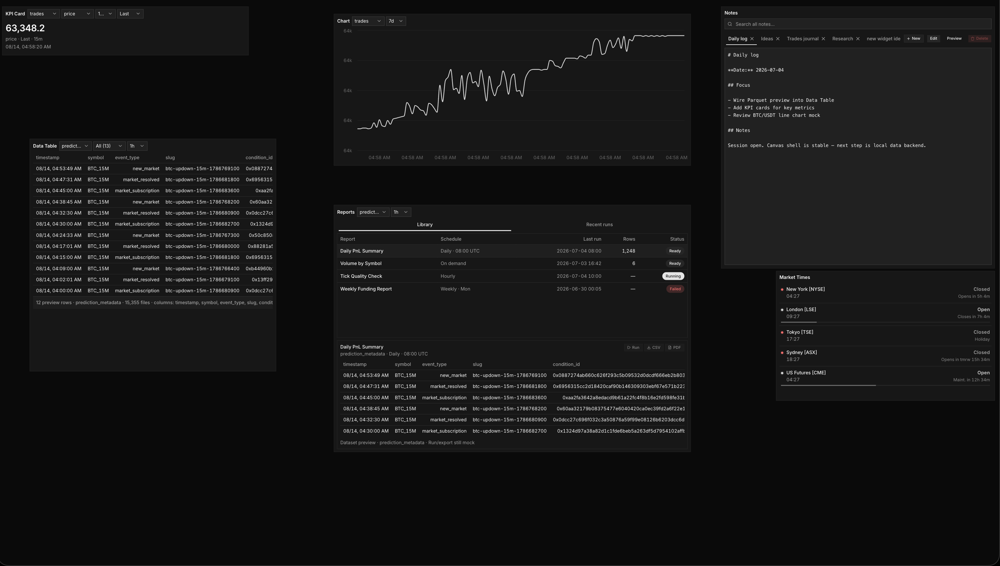
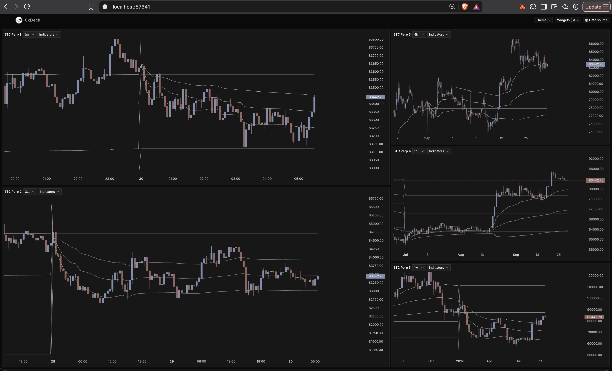

# 0xDeck

A market research workspace canvas for building **reusable** custom trading and research widgets.

Start from a blank canvas. Add built-in panels. Create your own widgets — register once, add many instances, port from other projects.



## Why this exists

Most market tools force a fixed workflow. 0xDeck gives you a surface you can reshape around your own research process.

## What you can build

- Research dashboards
- Strategy monitoring panels
- Bot control surfaces
- Dataset explorers
- Trade review workspaces
- Custom market workflows

## What you get

| Area | Details |
|------|---------|
| **Canvas** | Blank draggable workspace; resize, overlap, stack, and persist panels |
| **Backend** | FastAPI + DuckDB — flat `.parquet` files and nested **streams** (`trades`, `prediction_price`, …) |
| **Widgets** | Data Table, Chart, KPI Card, Dashboard, Reports (preview), Notes, Market Times, **BTC Perpetual** (Binance USD-M + Hyperliquid) |
| **Reusable widgets** | Register a template once in `src/widgets/registry/definitions.tsx`; add many instances; each keeps its own config |
| **Custom widgets** | Add your own panels through `WIDGET_REGISTRY` (`src/widgets/registry/`) |
| **Data binding** | Per-widget dataset, columns, time range (`15m`–`7d`), KPI metric + aggregation |
| **Themes** | 7 built-in palettes — Neutral, Stone, Mauve, Taupe, Olive, Black (`#000000` background; Neutral-derived), Cream (warm light) |
| **Persistence** | Workspace layout + widget config in `localStorage` (`0xdeck-*` keys) |

**Stack:** Vite · React 19 · TypeScript · Tailwind v4 · shadcn/ui · [react-grid-layout](https://github.com/react-grid-layout/react-grid-layout) v2 · FastAPI · DuckDB

The draggable canvas grid is built on **react-grid-layout** — drag, resize, overlap, and layout persistence all flow through it.

## Reusable widget model

Widgets are **templates + instances**:

- Register once in `src/widgets/registry/definitions.tsx` → appears in the **Widgets** menu (`panels.ts` handles instances and layout)
- Each add creates a unique instance (`chart-a1b2c3`) with its own layout slot and settings
- Shell (title, header dropdowns, close, drag) is shared — you only build the **body**
- Port widget logic from another project: libs under `src/lib/`, body in `*Panel.tsx`, one registry entry

See [docs/WIDGET-GUIDE.md](docs/WIDGET-GUIDE.md) for the full path.

## Create your own widget

Widget creation is intentionally small:

1. Add a `WidgetDefinition` in `src/widgets/registry/definitions.tsx`
2. Create a panel component, e.g. `src/MyWidgetPanel.tsx` (implements `WidgetInstanceProps`)
3. Widget picker and grid shell pick up the registry entry automatically

Use [docs/WIDGET-STANDARD.md](docs/WIDGET-STANDARD.md) for rules, [templates/widget/README.md](templates/widget/README.md) to start from a copy-paste body, and [docs/WIDGET-GUIDE.md](docs/WIDGET-GUIDE.md) for wiring details.

## Quick start

### 1. Frontend

```bash
git clone https://github.com/0xAnre/0xDeck.git
cd 0xDeck
npm install
npm run dev
```

Open [http://localhost:57341](http://localhost:57341).

### 2. Backend (Parquet data)

```bash
cd backend
python3 -m venv .venv
source .venv/bin/activate   # Windows: .venv\Scripts\activate
pip install -r requirements.txt
python scripts/generate_sample.py   # optional — writes data/sample/market_ticks.parquet
uvicorn app.main:app --reload --port 57342
```

### 3. Connect data in the UI

**Data source** → set your Parquet folder (absolute path) → **Save**. Registry refreshes automatically.

Add widgets, then use the header dropdowns on each panel to set dataset, columns, time range, and aggregation.

## BTC Perpetual widget

Live **BTC perpetual** chart (TradingView Lightweight Charts) with a header **Exchange** picker. The panel header shows only its dropdowns (**Exchange | Timeframes | Indicators | Tools**) — no static `BTC Perp` title. One **global read-only wallet** chosen in the app header (next to the workspace icons) supplies Entry/Close **Position Markers** on the existing candle series for every panel in every workspace:

- **Binance USD-M `BTCUSDT`** (default, unchanged) — REST klines + WebSocket relay.
- **Hyperliquid `BTC`** — `POST /info` `candleSnapshot` REST klines + WebSocket candle subscription relay. Fills come from a read-only Hyperliquid account address (`userFills` / `userFillsByTime`); the built-in address is the default.
- **Wallet: Lighter** — public Lighter mainnet REST (`/api/v1/account`, `/api/v1/trades`, market id `1` = BTC perp) from the browser. No wallet connection, signature, API key or trading permission. Lighter adds **markers only**; it is not a candle exchange.

Historical klines and VWAP context come from the backend REST API; candle updates use the backend WebSocket relay for the selected exchange (see [backend/README.md](backend/README.md)). Exchange selection is per widget instance and persisted under `0xdeck-widget-market-exchanges` (default `binance` when unset/invalid).



| Topic | Behavior |
|-------|----------|
| **Exchange** | `Binance` (default) / `Hyperliquid` — first header dropdown, per widget instance |
| **Candle colors** | Header **Appearance** (paintbrush button beside the screen and theme controls) → **Candle colors** opens the shared settings dialog with one row each for **Body**, **Borders** and **Wick**. Every part has its own rising/falling colors from the shared palette / custom HEX picker, an on/off checkbox and one 0–100 opacity slider shared by its two directions. Borders default to off and use the native 1px candle border; the dialog has no width or custom renderer. The whole record is global (`0xdeck-candle-colors`): it applies to every current and new BTC Perp panel in every workspace and on both candle exchanges, defaults to `#DBDBDB` / `#808080` with Body and Wick on, Borders off, every opacity 100, survives reload, and a theme switch never resets it. A legacy `{ rising, falling }` preference is kept across all three parts. `Save` applies in place without recreating the chart, resetting the viewport or refetching history; `Cancel`/`X`/`Esc`/outside click discard the draft, and `Reset` edits the draft only (Save still required). |
| **Timeframes** | `1m`, `5m`, `15m`, `30m`, `1H`, `2H`, `4h`, `1d`, `1w` for both exchanges (header interval picker; stored as `1h`/`2h`) |
| **Default** | `Binance`, `1m`, no indicators selected |
| **3 EMA** | EMA 13, 21, 35 — all timeframes |
| **2 EMA** | EMA 100 and EMA 200 together — all timeframes (independent of 3 EMA) |
| **Daily VWAP** | `1m`–`1d` including `15m`, `1h` and `2h` (not `1w`) |
| **Weekly VWAP** | `1m`–`1d` including `15m`, `1h` and `2h` (not `1w`) |
| **Monthly VWAP** | `4h`, `1d` only |
| **Quarterly VWAP** | `4h`, `1d` only |
| **Yearly VWAP** | `1d`, `1w` only |
| **Aggregated Liquidations** | Binance USD-M `BTCUSDT` live `forceOrder` liquidations, default **OFF**, enabled from the existing **Indicators** menu (independent of the selected chart exchange). Renders a dedicated pane: long liquidations red `#EF4444`, short liquidations green `#22C55E`, both as positive USD notional. `Position` **Bottom** grows bars upward and **Top** grows bars downward; a candle containing both sides shows both. Rebuckets on interval change and never draws outside the loaded candle range. On `30m` and above the pane reads the backend's per-interval buckets (`liquidations/buckets`) for the loaded range, so long ranges are not limited to the newest events; `15m` and below keep the paged events path. A coverage notice appears when the request/page cap limits history instead of leaving silent gaps. History is the SQLite store (live collection plus the optional parquet import); Binance `forceOrder` snapshots are **not** a complete market-wide liquidation total. Source `Hyperliquid`/`Both` are visibly disabled in V1. Settings persist per widget as `0xdeck-widget-liquidations-settings`. |
| **Indicator interaction** | Clicking an overlay indicator or indicator pane (3 EMA / 2 EMA / daily–yearly VWAP / rolling VWAP / RSI / Aggregated Liquidations) selects it with on-chart feedback (a halo stroke in the indicator's own color, or a pane rim for Aggregated Liquidations); double-click still opens its settings; `Esc` or a press elsewhere on the chart clears the selection. Selection is transient UI state and never changes the saved styling. |
| **Liquidation Levels** | Live **open-position liquidation prices** from MarketLens' public Hyperliquid L4 `liquidations` stream, default **OFF**, enabled from the existing **Indicators** menu. Bars are anchored to the candle pane's right edge and extend **left** at their liquidation price: long positions green `#22C55E`, short positions red `#EF4444`, both on one shared magnitude scale (default max bar width 25 % of the pane). It is a **current** profile, not executed liquidation history: panning to old candles keeps showing today's book, and the on-chart label says `LEV LIQ · LIVE`. Bars follow the candle price scale through pan, zoom, fractional offsets, resize, pane reorder and manual price-range drags, never add a price scale, autoscale or candle data. One shared socket serves every enabled panel; stale/reconnecting/resyncing states are shown instead of a stale book, `seq` gaps and epoch changes clear the book and resync, and disabling the last panel closes the socket. **Hyperliquid BTC only** — the menu row is disabled with "Hyperliquid only" wording on Binance. Hover a row for the price band, both sides' open size, the position count and the source/freshness. Settings (long/short color + opacity, max bar width) persist per panel as `0xdeck-widget-liquidation-levels-settings`; see [docs/MARKETLENS-LIQUIDATION-LEVELS.md](docs/MARKETLENS-LIQUIDATION-LEVELS.md). |
| **Initial history** | At least **500** candles when available; **last 120** visible on open. Active indicators preload their own warmup history automatically (EMA 100/200 target 1,000 bars, anchored VWAP back to its anchor) without requiring a viewport scroll. |
| **1w history** | If the selected exchange has fewer than 500 weekly candles, all available history is used |
| **Scroll left** | Older candles load on demand from the selected exchange (`/klines/history`) |
| **Mouse navigation** | Left-drag pans, wheel zooms, touch pinch/drag works, dragging the time or price axis scales that axis, and double-clicking an axis resets it. On the **candle pane**, right-button press-and-hold then drag scales **time and price together around the pressed chart point**: horizontal movement changes only the time scale (drag **right** → wider candles / fewer bars, drag **left** → narrower candles / more bars), vertical movement changes only the candle price range (drag **up** → taller candles / smaller price span, drag **down** → shorter candles / larger price span), and a diagonal drag applies both continuously. Scaling starts after the shared click/pan movement tolerance (`pointerMovementWithinClickTolerance`, 4 px), so a right click without moving changes nothing. The time and price under the original press stay at the same screen position (within rendering tolerance) instead of jumping to the chart center or the latest bar. Horizontal-only dragging never disables candle-price autoscale; vertical dragging enters the existing manual candle price-range mode through the public API, and the result is captured by the existing per-widget/per-interval viewport (`0xdeck-widget-market-chart-viewports`) and survives reload. The gesture is bound to the candle pane by series identity, so it follows pane reorder and never applies to the RSI or Aggregated Liquidations panes, and it never selects, moves, creates, deletes or edits a chart object. Because Chromium on macOS/Linux requests the native context menu on right-button press (before movement can be measured) and Chromium on Windows requests it on release, that menu is suppressed on the candle pane while a right-button gesture is pending or active and for the short `RIGHT_DRAG_CONTEXT_MENU_TAIL_MS` window (750 ms) after a drag ends; every other pane and widget keeps the native menu, and releases/cancels/lost capture always end the gesture cleanly. Implementation: `src/market/rightDragChartScaling.ts` (pure range/anchor math) + `src/market/rightDragChartScalingPointer.ts` (pointer lifecycle). |
| **Hyperliquid history limit** | Hyperliquid serves only the **most recent 5000 candles per interval**. Pagination is clamped to that horizon and an explicit "older data is unavailable" notice appears instead of substituting Binance data. Older anchored drawings/indicators may therefore remain partially unmet. |
| **Price tick / FRVP** | FRVP uses the selected exchange's price increment: Binance `0.1`, Hyperliquid 5 significant figures (≈`1` at BTC ~80k). Hyperliquid source intervals are provider-aware (including native `3m`); a profile range older than the provider's history window shows an explicit "history unavailable / available from" notice instead of an empty profile. |
| **Rolling VWAP** | Overlay instances (not a single on/off toggle). Add, enable/disable, open settings, or delete from the indicators menu. Settings cover fixed/auto period, min bars, standard-deviation multipliers and bands, per-band color, opacity, width (1–4 px) and `Line`/`Dot`, center-line color, opacity, `Line`/`Dot` and its own independent width (an instance saved before per-band widths inherits its stored line width), plus the existing shared band background fill color/opacity. Persisted per panel as `{ id, enabled, settings }[]` under `0xdeck-widget-rolling-vwap-instances`. `0xdeck-widget-rolling-vwap-settings` is legacy (read when migrating a pre-instance overlay; not written on save). The native centre line keeps its last-value label and price line, while the six band outlines and three fills render from one series primitive per instance — click/double-click, per-band halo, settings, hide/show/delete and persistence behave exactly as before. Renders only when its effective window fits the chart timeframe: 1D→1m, 1W→5m, 2W→15m, 1M→30m, 3M→1h, 6M→2h, 1Y→4h; longer windows are unsupported. |
| **Tools** | Header **Tools** menu when `headerSettings.tools` is true: **Fixed Range Volume Profile**, **Rectangle / Box**, **Line**, **Anchored VWAP**. FRVP instances persist (`0xdeck-widget-fixed-range-vp-instances`) and can be deleted from the menu. Their settings dialog groups row count, max bar width (% of the selected range), centered bar height (% of each price row), and per-direction up/down color + opacity under **Profile bars**; width/height are display-only, while row count (1–500) recomputes the profile bins. The legacy missing-field appearance is exactly 1/6-of-range maximum width at 100% row height. Rectangles persist (`0xdeck-widget-rectangle-instances`); create from the menu, select/move/resize on chart, lock/unlock, delete, and set fill (default `#A3A3A3` at `25%` opacity). Lines persist (`0xdeck-widget-line-instances`); create, select/move/resize, lock/unlock, delete, and style color, opacity, width and line type. Anchored VWAP drawings persist (`0xdeck-widget-anchored-vwap-instances`); place the anchor from the menu, drag it, lock/unlock, delete, and style the VWAP line plus three standard-deviation band pairs (upper/lower color and opacity, per-pair width and line type, optional band fill). |
| **Wallet control** | One compact wallet button at the left of the app header, next to the workspace icons. It picks the wallet **exchange** (`Hyperliquid` default / `Lighter`) and the wallet **address**, validates it with a readable error, and is the only wallet input — panels have none. The selection is global: it persists (`0xdeck-position-wallet`), applies across workspace switches and every current/new BTC Perp panel, and is independent of the panel's candle exchange. A Lighter wallet that owns several accounts must name the account there (no arbitrary pick, no mixing); a wallet with no Lighter account or no BTC position is a legitimate empty state. |
| **Account markers** | Wallet-scoped, default **OFF**. Toggle **Position Markers** in the existing **Indicators** menu (per widget, persisted as `0xdeck-widget-market-position-markers`) to render side-only markers on the existing candlestick series via `createSeriesMarkers`: buy fills → one green/up-token upward arrow, sell fills → one red/down-token downward arrow, at most one per side per candle bucket (max 2 markers). Arrow size is user-adjustable: the gear on the **Position Markers** row opens **Position Markers settings**, whose **Marker Size** slider runs **0.5×–3×** in **0.25** steps with default **1×** (`×` = the chart library's marker size); `Save` persists it, `Cancel`/`X`/`Esc` discards it. The same key stores `{ enabled, size }` per widget, and a legacy boolean record is migrated (toggle kept, size ⇒ `1×`). Size is presentation-only: color, shape, position and the one-marker-per-side-per-bucket rule never change. Hovering a candle lists every individual fill (time, side, price, size, position). No wallet connection, signature, API key or trading permission. Markers re-bucket on interval change, stay hidden outside loaded history, and never touch candle, indicator, VWAP, FRVP or drawing data. Account fills load only while the toggle is ON. |
| **Wallet sources** | **Hyperliquid**: fills page through `userFillsByTime`; a capped window shows an explicit truncation notice. Each panel keeps its own range-scoped Hyperliquid history request (unchanged, pre-existing behavior); only the live fills relay is shared per account. A wallet or exchange switch re-requests that panel's range for the new wallet even when the candle window did not move. **Lighter**: trades are read from the public `/api/v1/trades?account_index=…&market_id=1` (100 per page, cursor) and merged/deduped by trade id; the public API exposes at most the ~3000 most recent trades per account, and the panel says so instead of presenting that window as complete history. Every mounted panel shares one Lighter session (one discovery, one history walk, one 12 s newest-page poll) — a wallet/exchange switch clears the old fills, aborts in-flight requests and releases the session. A transient start failure (network/429/5xx) retries with capped backoff (1 s → 30 s) while the error stays visible. The account's BTC position is not part of the marker feed: the wallet menu checks it on open/save (and after choosing another Lighter account) and shows “No open BTC position” as a legitimate empty state. |
| **Persistence** | Global Position Markers wallet (`0xdeck-position-wallet`) and global candle colors (`0xdeck-candle-colors`), exchange, interval, indicators, liquidation settings, rolling VWAP, drawings and workspace layout survive refresh (see [AGENTS.md](AGENTS.md) persistence keys) |

Requires the backend on port **57342** (Vite proxies `/api` from **57341**).

## Workspace navigation

The outer workspace (`main.workspace-scroller` in `App.tsx`) scrolls vertically when panels extend below the viewport. Scrollbars are hidden for `.workspace-scroller` and `.panel-body` in `App.css` (content still scrolls).

**Screen shortcuts:** use the compact header controls for Screens 1–5, or press `m`, then `1`–`9` within ~500ms to jump to workspace screen positions 1–9 (scroll offsets 0…8 viewport heights). Both paths reuse the same smooth/locked alignment and persistence behavior; the active header control exposes the current screen. Keyboard shortcuts are ignored while focus is in an editable field. Implementation: `src/screenNavigationShortcuts.ts`. The active screen index is remembered per tab (`sessionStorage` key `0xdeck-workspace-screen`), so a refresh reopens the screen the tab was on; a new tab still starts on Screen 1.

**Screens 1–9 always exist:** a wrapper inside `main.workspace-scroller` reserves a virtual 9-viewport scroll extent (`resolveWorkspaceScreenExtentHeight`), so empty screens below the last panel are still reachable. Widget positions and sizes are unchanged by screen navigation; the persisted `0xdeck-workspace` payload now holds one lg layout per workspace ([AGENTS.md](AGENTS.md) persistence keys).

**Screen Lock:** the icon-only header toggle is grouped with Screens 1–5 and pins the workspace to the active screen (in-memory, not persisted). Hover or focus any compact header control for its tooltip; every icon-only trigger also has an accessible name.

- **OFF** — free vertical workspace scrolling, exactly as before.
- **ON** — wheel, trackpad, keyboard and focus scrolling cannot leave the active screen; any offset is returned to that screen's exact top, so the workspace never rests between two screens. `m` then `1`–`9` still jumps to the requested screen's top (instant, no animation). Turning the lock ON from an arbitrary offset aligns to the nearest screen, or to the destination of an `m` + digit jump that is still animating; resizing the viewport re-aligns to the active screen at the new height.
- Widget interactions are unaffected: panel drag/resize, `.panel-body` internal scrolling and BTC Perp chart zoom/pan/drawings keep working because the lock only watches the workspace scroller.

## Documentation

| Guide | Description |
|-------|-------------|
| [docs/README.md](docs/README.md) | Documentation index + typical workflows |
| [docs/WIDGET-GUIDE.md](docs/WIDGET-GUIDE.md) | Add widgets, wire live data, formatters |
| [docs/THEME-GUIDE.md](docs/THEME-GUIDE.md) | Themes, tokens, shell rules |
| [backend/README.md](backend/README.md) | API reference — preview, series, KPI, time range |
| [docs/NEXT-STEPS.md](docs/NEXT-STEPS.md) | Roadmap |
| [AGENTS.md](AGENTS.md) | Architecture + AI agent conventions |
| [docs/PRODUCT-POSITIONING.md](docs/PRODUCT-POSITIONING.md) | Product positioning + UX direction |

## Project layout

```
src/
  App.tsx                  Shell, grid, header
  panels.ts                Widget catalog + instance ids
  context/ParquetDataContext.tsx
  api/client.ts            Backend client
  *Panel.tsx               Widget bodies
backend/
  app/                     FastAPI + DuckDB
  scripts/generate_sample.py
docs/                      Guides (see docs/README.md)
```

## Key files

| File | Role |
|------|------|
| `src/layoutStorage.ts` | Workspace layout persistence (app adapter over `src/lib/workspaceStorage.ts`) |
| `src/lib/workspaceStorage.ts` | Pure workspace persistence core (grid migration, restore/patch, load/save) |
| `src/lib/workspaceScope.ts` | Fallback active-workspace accessor for workspace-scoped storage keys (mounted widgets pass their workspace id explicitly) |
| `src/datasetStorage.ts` | Per-widget dataset + per-workspace Data Table defaults |
| `src/timeRangeStorage.ts` | Per-widget time range |
| `src/kpiStorage.ts` | KPI metric + aggregation per widget |
| `backend/.canvas-state.json` | Parquet folder path (gitignored) |

## Credits

| Project | Role | License |
|---------|------|---------|
| [react-grid-layout](https://github.com/react-grid-layout/react-grid-layout) | Draggable, resizable widget grid | MIT |
| [shadcn/ui](https://ui.shadcn.com) | UI components | MIT |
| [Recharts](https://recharts.org) | Charts | MIT |

See `package.json` for the full dependency list. Third-party packages keep their original licenses.

## GitHub

Repository: [github.com/0xAnre/0xDeck](https://github.com/0xAnre/0xDeck)

Suggested **description**:

> A market research workspace canvas for building reusable market research widgets on a draggable canvas.

Suggested **topics**: `reusable-widgets`, `widget-canvas`, `market-research`, `react-grid-layout`, `parquet`, `shadcn-ui`, `fastapi`, `duckdb`

## License

**Non-commercial** — see [LICENSE](LICENSE).

- Personal, educational, and private research use: allowed
- Commercial use: requires written permission from the copyright holder
- No warranty
